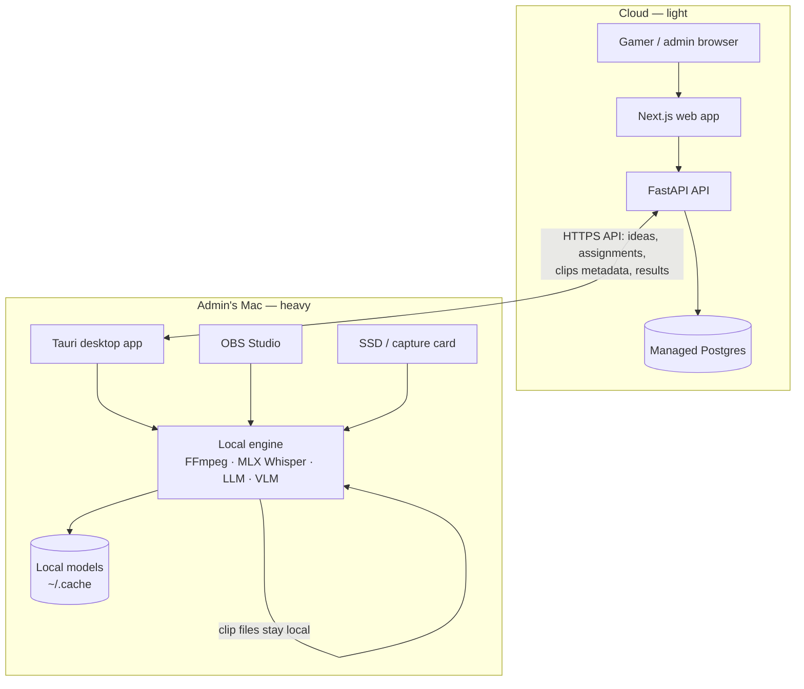

# Architecture — cloud web + desktop engine

The platform has two halves that cannot live in the same place. This document is
the decision and the contract between them.

## The split

| | Cloud website | Desktop app |
| --- | --- | --- |
| Runs on | A small VPS / managed platform + managed Postgres | The admin's own Mac |
| Serves | Every gamer and every admin planning task | The admin's clip engine |
| Data | Accounts, sessions, games, ideas, assignments, calendar, metrics | Recordings, clips, local models, capture |
| Heavy work | None. No video, no models. | FFmpeg render, MLX Whisper, the LLM, the vision model |
| Reaches | Any browser, any device | One machine with the footage and the models |

**Why.** A 20 GB recording and an 18 GB model cannot run on a web host, and
uploading either defeats the point. The cloud is the shared source of truth for
*what to play*; the desktop is where *the clip is made*. Nothing heavy crosses
the wire.

## Diagram

The desktop app talks to the **same API and database** as the cloud web app. It
does not have a second backend. It reads the ideas and assignments the admin
approved in the browser, does the heavy work locally, and writes back only
metadata (clip state, transcripts, metrics) — never the source recording.

## The one API contract

The contract is the existing HTTP API (`contracts/openapi.yaml`). The desktop app
is a client of it, exactly like the browser. The endpoints it depends on:

| Direction | Endpoints | What moves |
| --- | --- | --- |
| Desktop → cloud | `POST /auth/sign-in`, `GET /auth/csrf` | Email + password, session cookie |
| Cloud → desktop | `GET /today`, `GET /missions/{id}`, `GET /admin/pool` | The dares and ideas to play |
| Desktop → cloud | `POST /studio/upload`, `POST /studio/detect`, `GET /studio/recordings` | A local recording's metadata, never the bytes unless the admin uploads |
| Cloud → desktop | `GET /studio/recordings/{id}` | Ranked candidates, including vision suggestions |
| Desktop → cloud | `POST /studio/generate`, `POST /clips/{id}/commentary` | Clip metadata and the commentary text |
| Cloud → desktop | `GET /clips`, `GET /admin/calendar`, `GET /results` | Review, scheduling and metrics |

**The rule:** the API never asks the cloud to render, transcribe or download a
model. Every endpoint that touches media either (a) streams a file the client
already has locally, or (b) returns metadata. If a future endpoint needs to move
a 20 GB file, it belongs on the desktop side.

## What runs where, concretely

**Cloud (deployed by `docs/deploy-web.md`):**

- `web/` — the Next.js app (all pages, both roles).
- `api/` — FastAPI: accounts, sessions, games, research, missions, calendar,
  results, community, and the studio *metadata* endpoints.
- Managed Postgres (Neon or a self-managed instance).
- Optional: the `relay/` MediaMTX stream server for the Go-Live RTMP ingest.

**Desktop (installed by `docs/desktop-app.md`):**

- The Tauri shell (`desktop/`).
- The local engine: FFmpeg, MLX Whisper, the Ollama models, the vision model.
- The host bridges (`local/mlx_bridge.py`, `local/ssd_bridge.py`).
- OBS Studio (integrated over obs-websocket) **or** the bundled FFmpeg recorder.
- The SSD reader.

## Consequences

- **One database.** A gamer's Today, an admin's pool and the desktop's studio
  read the same rows. There is no sync step to go wrong.
- **The desktop can be offline.** It caches the last idea/assignment and keeps
  clipping; it writes back when the network returns. The web app is the only
  half that needs the network.
- **The cloud stays cheap.** No GPU, no large disk, no model downloads. It can
  run on the smallest managed plan.
- **The heavy half is the user's responsibility.** The desktop app must say so
  honestly: it needs the Mac, the models and the footage.
