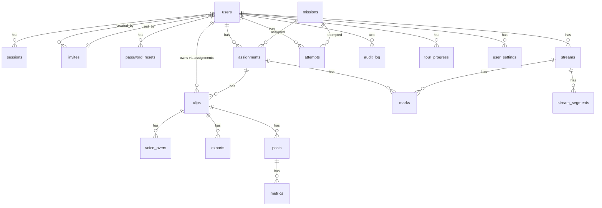

# 04 — Data model

PostgreSQL 16. Schema is created by numbered migrations in
`api/app/migrations/`, applied once each and recorded in `schema_migrations`
(`api/app/db.py:migrate`). The old `api/app/schema.sql` is **not** applied any
more (see 14).

## Migration history

| File | Adds |
| --- | --- |
| `0001_init.sql` | the Sprint-5 domain tables: users, channels, oauth_tokens, missions, daily_sets, assignments, streams, marks, clips, posts, metrics, attempts, templates, jobs, sessions, stream_segments |
| `0002_accounts.sql` | email/password columns, invites, password_resets, login_attempts, audit_log, tour_progress, ai_usage, user_settings, clip stage/trim/transcript/voice columns, voice_overs, exports, job error/retry/idempotency |
| `0003_render_key.sql` | `clips.render_key` for render idempotency |
| `0004_studio.sql` | `studio_recordings`, `studio_candidates` (Sprint 7 clip studio) |

Verified on an empty database: 26 tables, no errors.

## Tables

### People and access

**users** — `id uuid PK`, `google_subject text NULL` (legacy), `email text NULL`,
`display_name text NULL`, `role text NOT NULL default 'creator'`,
`password_hash text NULL`, `failed_logins int NOT NULL default 0`,
`locked_until timestamptz NULL`, `last_login_at timestamptz NULL`,
`created_by_invite uuid NULL`, `created_at timestamptz`. Written by
`api/app/auth.py` (sign-up, dev sign-in), `api/app/create_admin.py`,
`api/app/admin.py` (role), `api/app/account.py` (delete).

**sessions** — `token text PK`, `user_id uuid → users`, `created_at`,
`expires_at`. Written by `auth.py`.

**invites** — `id uuid PK`, `code text UNIQUE`, `email text NULL`,
`created_by uuid → users`, `created_at`, `expires_at`, `used_by uuid → users`,
`used_at`, `revoked_at`. Written by `admin.py` (create/revoke), `auth.py` (use).

**password_resets** — `token_hash text PK`, `user_id uuid → users`,
`created_by uuid → users`, `created_at`, `expires_at`, `used_at`. Written by
`admin.py` (create link), `auth.py` (consume).

**login_attempts** — `id uuid PK`, `email text`, `ip text NULL`, `ok boolean`,
`created_at`. Written by `auth.py` (rate limiting/lockout).

**audit_log** — `id uuid PK`, `actor_id uuid → users NULL`, `action text`,
`target_type text`, `target_id text`, `meta jsonb`, `created_at`. Written by
`api/app/users.py:audit()` from `admin.py`, `auth.py`, `account.py`,
`missions.py`.

**user_settings** — `user_id uuid PK → users`, `caption_style text`,
`layout_preference text`, `voice_over_default boolean`, `voice text NULL`,
`updated_at`. Written by `account.py`.

**tour_progress** — `user_id uuid → users`, `tour_id text`,
`step_index int`, `completed boolean`, `skipped boolean`, `updated_at`;
PK `(user_id, tour_id)`. Written by `tours.py`.

**ai_usage** — `id uuid PK`, `user_id uuid NULL`, `page text`, `kind text`,
`provider text`, `model text`, `prompt_tokens int`, `completion_tokens int`,
`latency_ms int`, `fallback boolean`, `created_at`. Written by `ai.py`.

### Missions and play

**missions** — `id text PK` (e.g. `m_0214`), `card jsonb`, `score float`,
`status text` (`candidate`/`unverified`/`rejected`), `type text NULL`,
`created_at`. Written by `missions.py`.

**assignments** — `id uuid PK`, `user_id → users`, `mission_id → missions`,
`date date`, `state text`, `created_at`. Written by `missions.py`
(accept/swap) and `clips.py` (upload).

**streams** — `id uuid PK`, `user_id → users`, `stream_key_hash text`,
`started_at`, `ended_at NULL`, `storage_prefix text NULL`. Written by
`clips.py` (`POST /streams`, upload).

**stream_segments** — `id uuid PK`, `stream_id → streams`, `path text`,
`duration float`, `created_at`. Written by `hooks.py`.

**marks** — `id uuid PK`, `assignment_id → assignments NULL`,
`stream_id → streams NULL` (nullable), `kind text` (`start`/`done`),
`stream_time float`, `result text NULL`, `created_at`. Written by `clips.py`.

**clips** — `id uuid PK`, `assignment_id → assignments NULL`,
`file_key text NULL`, `title text NULL`, `state text`, `template text NULL`,
`duration_seconds float NULL`, `stage text NULL`, `progress int`,
`error text NULL`, `transcript jsonb NULL`, `source_start float NULL`,
`source_end float NULL`, `recording_key text NULL`, `trim_start float NULL`,
`trim_end float NULL`, `layout text NULL`, `caption_style text`,
`voice_over boolean`, `voice text NULL`, `voice_key text NULL`,
`export_title text NULL`, `export_description text NULL`,
`export_tags jsonb NULL`, `render_key text NULL`, `created_at`. Written by
`clips.py` and `worker/worker_app/handlers.py`.

**attempts** — `id uuid PK`, `mission_id → missions`, `user_id → users`,
`result_value float NULL`, `clip_id → clips NULL`, `created_at`. Written by
`clips.py` (upload); read by `community.py`.

**voice_overs** — `id uuid PK`, `clip_id → clips`, `voice text`, `text text`,
`audio_key text NULL`, `duration float NULL`, `state text`, `created_at`.
Written by `clips.py` (row) and `worker/worker_app/handlers.py` (audio).

**exports** — `id uuid PK`, `clip_id → clips`, `title text NULL`,
`description text NULL`, `tags jsonb`, `video_key text NULL`,
`thumb_key text NULL`, `state text`, `created_at`. Written by `clips.py`.

### Results and publishing

**posts** — `id uuid PK`, `clip_id → clips`, `platform text`, `remote_id text`,
`posted_at`, `state text`. Written by `account.py` (manual metric).

**metrics** — `id uuid PK`, `post_id → posts`, `views int`,
`avg_view_percentage float NULL`, `watch_time_seconds float NULL`,
`collected_at`. Written by `account.py`.

**channels** / **oauth_tokens** — legacy Google/YouTube tables. No writer in the
current code (Google sign-in is not built).

**daily_sets** — legacy Daily Mission table. No writer.

**templates** — `id text PK`, `config jsonb`, `weight int`. Read by `admin.py`;
no writer, so the Templates page is always empty.

### Job queue

**jobs** — `id uuid PK`, `kind text`, `payload jsonb`, `state text`
(`queued`/`running`/`done`/`failed`), `attempts int`, `available_at`,
`locked_by text NULL`, `error text NULL`, `retry_count int`,
`idempotency_key text UNIQUE NULL`, `created_at`, `updated_at`.
Written by `clips.py` (enqueue), `admin.py` (retry), `worker/worker_app/jobs.py`
(claim/finish/fail).

**Job types** (`worker/worker_app/handlers.py`): `render_clip`, `preview_voice`.

**Retry** (`worker/worker_app/jobs.py`): on failure `retry_count += 1`,
`delay = min(300, 5 × 2^retry_count)` seconds, `queued` while
`retry_count < MAX_RETRIES (5)`, else `failed`. The stale reaper returns
`running` jobs to `queued` after `WORKER_STALE_SECONDS`.

## Entity diagram

